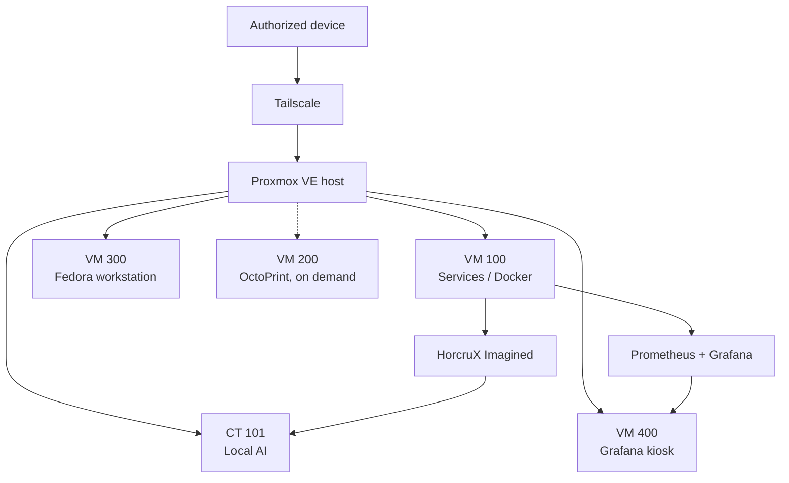

# HORCRUX Homelab

**A single-node Proxmox homelab run like a small production environment:** documented, monitored, recoverable, and changed one verified step at a time.

This repository is the public, sanitized portfolio view of HORCRUX. It shows how the lab is built and operated. Real addresses, hostnames, credentials, and private configuration are kept out on purpose (see [SECURITY.md](SECURITY.md)).

## At a glance

| Layer | What runs there |
| --- | --- |
| Host | HP EliteDesk 800 G3 Mini (i5-6500T), Proxmox VE, LVM-thin on NVMe |
| Services VM | Ubuntu Server 26.04 LTS running 17 containers in 9 Compose projects |
| Local AI | Debian LXC running Ollama (Qwen 3.5 9B) behind an authenticated bridge |
| Dashboard | **HorcruX Imagined**: a custom web dashboard with a built-in local AI assistant |
| Monitoring | Prometheus, Blackbox Exporter, Node Exporter, cAdvisor, Grafana, and a physical kiosk display |
| DNS | AdGuard Home for the whole LAN, with a real DNS-resolution probe |
| Media and cloud | Jellyfin and Nextcloud, both private |
| Workstation | Fedora 44 desktop VM over RDP |
| On-demand | OctoPrint VM for 3D printing, off unless printing |
| Access | Tailscale only. Nothing is port-forwarded from the internet. |

## What this project demonstrates

- **Virtualization:** guest sizing, dependency-ordered autostart, memory ballooning, iGPU passthrough, snapshot discipline
- **Containers:** a consistent one-folder-per-service Compose layout, pinned project names, safe migrations with rollback
- **Monitoring:** black-box probes for every user-facing service, including a real DNS lookup, a token-protected API counted as healthy on `401`, and a maintenance-aware Nextcloud check
- **Observability UX:** a Grafana command center with a service timeline, 7-day uptime SLO tiles, and hardware thresholds
- **Change management:** snapshot, then one change, then validate, then verify, with rollback kept as a separate step
- **Recovery:** reboot rehearsals, restore runbooks, and honest tracking of backup gaps
- **Documentation:** a public sanitized repo, a private operational record, and a printable binder

## Read next

| Document | What's inside |
| --- | --- |
| [Architecture](docs/architecture.md) | Guests, boot order, service layout, access model |
| [Monitoring](docs/monitoring.md) | Probe design, custom Blackbox modules, Grafana layout |
| [Operations](docs/operations.md) | Change workflow, maintenance schedule, backup strategy and current status |
| [Case study: September 2026 reorganization](case-studies/2026-09-reorganization.md) | Simplifying the whole environment without downtime surprises |
| [Runbooks](runbooks/) | Step-by-step procedures used in practice |

## Related tools

- [horcrux-proxmox-health-check](https://github.com/Pneumatocyst/horcrux-proxmox-health-check): a read-only Bash health report for Proxmox hosts, with CI and releases
- [it-support-toolkit](https://github.com/Pneumatocyst/it-support-toolkit): cross-platform PowerShell/Bash support utilities

## Status

Operational. The top open item is replacing a failed external backup SSD and re-verifying nightly guest backups. Offsite backup and a full restore rehearsal come after that. Progress is tracked in [Operations](docs/operations.md#open-work).

## License

Documentation and examples are released under the [MIT License](LICENSE).
