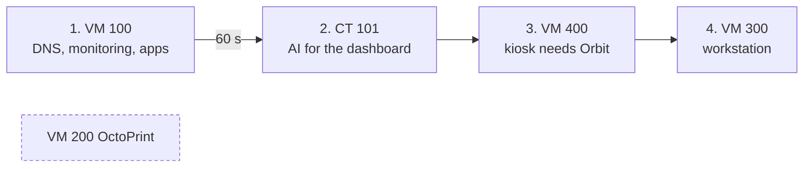
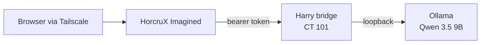

# Architecture

Baseline: September 2026, updated October 2026. Addresses and identifying details are intentionally omitted.

## Host

| Component | Detail |
| --- | --- |
| Hardware | HP EliteDesk 800 G3 Desktop Mini, Intel Core i5-6500T (4C/4T) |
| Memory | About 23 GiB usable (32 GB upgrade planned) |
| Storage | 256 GB NVMe (Proxmox + LVM-thin), external SSD for media, dedicated USB drive for guest backups (replaced October 2026) |
| Hypervisor | Proxmox VE 9.2, kernel 7.0 |
| Network | Single gigabit uplink via an 8-port switch; Linux bridge `vmbr0` |

## Guests

| ID | Role | OS | Resources | Autostart |
| --- | --- | --- | --- | --- |
| VM 100 | Services (all Docker workloads) | Ubuntu Server 26.04 LTS | 2 vCPU, 6 GB, 64 GB | Order 1, 60 s settle |
| CT 101 | Local AI (Ollama + bridge) | Debian 13 LXC | 4 cores, 8 GB, 20 GB | Order 2 |
| VM 400 | HorcruX Orbit kiosk on a physical portrait monitor | Debian 13 + Xfce + Chromium | 2 vCPU, 2 GB, 16 GB | Order 3 |
| VM 300 | Always-on desktop workstation | Fedora 44 GNOME (RDP) | 4 vCPU, 8 GB (balloon min 4 GB), 48 GB | Order 4 |
| VM 200 | 3D-printer server | Ubuntu + OctoPrint | 2 vCPU, 2 GB, 20 GB | Off; started on demand |

### Boot order



The order follows dependencies. The kiosk is useless until the services VM is up, and the dashboard's assistant needs the AI container. The printer VM stays off to save memory and only runs while printing, and monitoring shows it as *expected offline* (yellow) rather than failed (red).

### Memory budget

Configured maximums total about 24 GB on a host with about 23 GiB usable. That works because the workstation balloons down to 4 GB under pressure. With every autostart guest running, the host still has about 8 GiB available.

## Service layout

Every Compose project on VM 100 lives in its own folder under `/opt/horcrux`:

```text
/opt/horcrux/
├── adguard/            AdGuard Home (LAN and tailnet DNS)
├── imagined/           HorcruX Imagined dashboard
├── orbit/              HorcruX Orbit live observatory (kiosk view)
├── jellyfin/           Media server
├── monitoring/         Prometheus, Grafana, Blackbox, Node Exporter, cAdvisor
├── nextcloud/          Nextcloud + MariaDB + Redis + cron
├── portainer/          Container management UI
├── speedtest-tracker/  Scheduled internet speed tests
├── uptime-kuma/        Secondary status monitor
├── sentinel/           Small read-only collector API (systemd)
├── scripts/            Terminal control deck and maintenance scripts
└── _archive/           Superseded configs, kept for rollback
```

Design rules:

- **One folder per service.** `cd /opt/horcrux/<service> && docker compose ps` works the same everywhere.
- **Pinned project names.** Projects that moved folders set a top-level `name:`, so Docker network and volume names stay stable.
- **Relative bind mounts.** A service folder carries its own data and can be moved as a unit.
- **Nothing deleted during a migration.** Old files go to `_archive/` until the change has proven itself.
- **`restart: unless-stopped`** on every container. A VM reboot rehearsal confirmed everything recovers unattended.

## HorcruX Imagined and the local AI



- Imagined is a custom dashboard (Python, read-only container, pinned image digest) bound only to the Tailscale interface.
- Its assistant, *Harry*, answers recognized health questions directly from fresh metrics, with no model call needed. Broader questions go to a local 9B model.
- The model server listens on loopback only. The only way in is an authenticated bridge, and an unauthenticated request gets `401` by design.
- If the internet is down, the assistant keeps working locally and says so.
- Imagined reads Proxmox with its own API token: read-only everywhere, plus power control on the on-demand printer VM only. The Proxmox certificate is pinned by fingerprint instead of skipping verification.

## HorcruX Orbit

Orbit is a 3D observatory that runs on the kiosk. It needs no credentials: it reads Imagined's cached snapshot every 3 seconds, Prometheus every 2 seconds for live per-container and per-guest network rates, and a metadata-only scan of the media library. It runs read-only with all capabilities dropped, tight memory and CPU limits, and a tailnet-only bind. See the [October 2026 case study](../case-studies/2026-10-backups-and-orbit.md).

## Access model

- **Tailscale is the only remote path.** No public port forwarding, no Funnel.
- Admin UIs (Proxmox, Portainer, AdGuard) are private-LAN or tailnet only.
- The dashboard and the collector API bind to the tailnet interface only.
- Backends that don't need publishing (the Nextcloud app server, Prometheus, the model server) listen on loopback or internal Docker networks.

## Retired components

- A general-purpose start page (Homepage), replaced by HorcruX Imagined.
- The Grafana view on the kiosk, replaced by HorcruX Orbit. Grafana still serves the command center.
- An earlier workstation VM and a laptop-hosted AI gateway, replaced by the server-side AI container.
