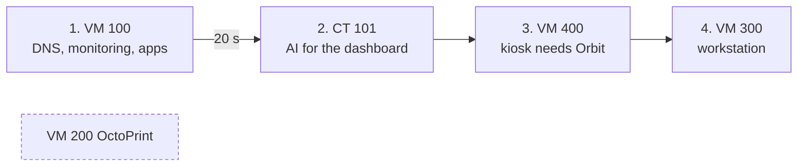
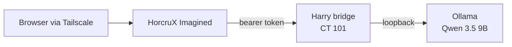

# Architecture

Live audit: November 12, 2026. Addresses and identifying details are intentionally omitted.

## Host

| Component | Detail |
| --- | --- |
| Hardware | HP EliteDesk 800 G3 Desktop Mini, Intel Core i5-6500T (4C/4T) |
| Memory | About 23 GiB usable (32 GB upgrade planned) |
| Storage | 256 GB NVMe (Proxmox + LVM-thin), external SSD for media, dedicated USB drive for guest backups (replaced October 2026) |
| Hypervisor | Proxmox VE 9.2, kernel 7.0 |
| Network | Single gigabit uplink via an 8-port switch; Linux bridge `vmbr0` |

## Guests

| ID | Role | OS | Resources | Autostart |
| --- | --- | --- | --- | --- |
| VM 100 | Services (all Docker workloads) | Ubuntu Server 26.04 LTS | 2 vCPU, 6 GB, 64 GB | Order 1, 20 s settle |
| CT 101 | Local AI (Ollama + bridge) | Debian 13 LXC | 4 cores, 8 GB, 32 GB | Order 2 |
| VM 400 | HorcruX Orbit kiosk on a physical portrait monitor | Debian 13 + Xfce + Chromium | 2 vCPU, 3 GB, 16 GB | Order 3 |
| VM 300 | Always-on desktop workstation | Fedora 44 GNOME (RDP) | 4 vCPU, 8 GB (balloon min 4 GB), 48 GB | Order 4 |
| VM 200 | 3D-printer server | Ubuntu + OctoPrint | 2 vCPU, 2 GB, 20 GB | Off; started on demand |

### Boot order



The order follows dependencies. The kiosk is useless until the services VM is up, and the dashboard's assistant needs the AI container. The printer VM stays off to save memory and only runs while printing, and monitoring shows it as *expected offline* (yellow) rather than failed (red).

### Memory budget

Always-on guest memory ceilings total 25 GiB on a host with about 23.3 GiB usable. The workstation has a 4 GiB balloon minimum; the audit found about 7 GiB available on the host without active swapping in a short sample. This is a point-in-time observation, not a capacity stress test. Two stopped guests add another 2.5 GiB if started. An experimental 512 MiB DreamOS guest is stopped and excluded from the nightly backup job.

## Service layout

VM 100 runs 23 containers across 13 Compose projects. Most projects live under `/opt/horcrux`; monitoring currently uses a separate infrastructure checkout. The repository is a source snapshot, not a complete representation of every live project:

```text
/opt/horcrux/
├── adguard/            AdGuard Home (LAN and tailnet DNS)
├── imagined/           HorcruX Imagined dashboard
├── orbit/              HorcruX Orbit live observatory (kiosk view)
├── jellyfin/           Media server
├── monitoring/         Prometheus, Grafana, Blackbox, Node Exporter, cAdvisor
├── nextcloud/          Nextcloud + MariaDB + Redis + cron
├── discord-harry/     Assistant integration
├── kiwix/             Offline reference library
├── romm/              Game library
├── proxy/             Reverse proxy
├── scrutiny/          Disk monitoring web app + database
├── speedtest-tracker/  Scheduled internet speed tests
├── torrents/           Download service + exporter
├── scripts/            Terminal control deck and maintenance scripts
└── _archive/           Superseded configs, kept for rollback
```

Design rules:

- **One folder per service.** `cd /opt/horcrux/<service> && docker compose ps` works the same everywhere.
- **Pinned project names.** Projects that moved folders set a top-level `name:`, so Docker network and volume names stay stable.
- **Relative bind mounts.** A service folder carries its own data and can be moved as a unit.
- **Nothing deleted during a migration.** Old files go to `_archive/` until the change has proven itself.
- **`restart: unless-stopped`** on every container. A VM reboot rehearsal confirmed everything recovers unattended.

## HorcruX Imagined and the local AI



- Imagined is a custom dashboard (Python, read-only container, pinned image digest) bound only to the Tailscale interface.
- Its assistant, *Harry*, answers recognized health questions directly from fresh metrics, with no model call needed. Broader questions go to a local 9B model.
- The model server listens on loopback only. The only way in is an authenticated bridge, and an unauthenticated request gets `401` by design.
- If the internet is down, the assistant keeps working locally and says so.
- Imagined reads Proxmox with its own API token: read-only everywhere, plus power control on the on-demand printer VM only. The Proxmox certificate is pinned by fingerprint instead of skipping verification.

## HorcruX Orbit

Orbit is a 3D observatory that runs on the kiosk. It needs no credentials: it reads Imagined's cached snapshot every 3 seconds, Prometheus every 2 seconds for live per-container and per-guest network rates, and a metadata-only scan of the media library. It runs read-only with all capabilities dropped, tight memory and CPU limits, and a tailnet-only bind. See the [October 2026 case study](../case-studies/2026-10-backups-and-orbit.md).

## Access model

- **Tailscale is the only remote path.** No public port forwarding, no Funnel.
- Admin UIs (Proxmox, AdGuard) are private-LAN or tailnet only.
- Imagined and Orbit use private access. The former Sentinel collector has been retired.
- The Nextcloud app backend and model server remain internal. Prometheus listens on loopback and the tailnet. Some older service ports bind to all interfaces; router forwarding and ACLs were not audited, so binding alone does not establish internet exposure.

## Retired components

- A general-purpose start page (Homepage), replaced by HorcruX Imagined.
- The Grafana view on the kiosk, replaced by HorcruX Orbit. Grafana still serves the command center.
- An earlier workstation VM and a laptop-hosted AI gateway, replaced by the server-side AI container.

Portainer, Uptime Kuma, and Sentinel are archived and absent from the live service inventory. VM 400 runs the Orbit browser/controller; its current Chromium process uses a maximized window rather than the `--kiosk` flag. The physical display was not inspected during this audit.
