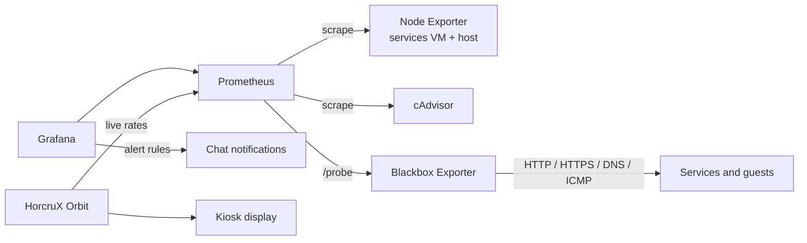

# Monitoring

HORCRUX uses black-box monitoring: every user-facing service is probed the way a user would reach it, and the results feed a Grafana command center. Grafana alert rules post to a chat channel, and the physical kiosk shows HorcruX Orbit, which reads the same Prometheus data.



## Probe design

Every probe carries a `service` label, so dashboards and queries never depend on addresses.

| Probe type | Services | Why it's built this way |
| --- | --- | --- |
| HTTP `2xx` | Dashboard (`/healthz`), media server, status page, DNS admin UI, speed tracker, collector API | Proves the app answers, not just that the port is open |
| HTTPS (self-signed) | Container management UI | Internal certificate, still verifies the service responds |
| **DNS lookup** | AdGuard Home | A real `A` record query. The web UI can be up while DNS is broken, and only this catches it. |
| **HTTP `200` or `401`** | Local AI bridge | The bridge requires a token, so `401` means *alive and guarding the door* |
| **Nextcloud status** | Nextcloud | Checks `"installed": true` and fails if maintenance mode is on |
| ICMP | Workstation and printer VMs | Guest reachability; the printer VM is expected to be off |

### Custom Blackbox modules

```yaml
modules:
  dns_udp:
    prober: dns
    timeout: 5s
    dns:
      query_name: "example.com"
      query_type: "A"
      valid_rcodes: [NOERROR]

  http_2xx_401:
    prober: http
    timeout: 5s
    http:
      method: GET
      valid_status_codes: [200, 401]

  http_nextcloud:
    prober: http
    timeout: 5s
    http:
      method: GET
      headers:
        Host: "<TRUSTED_DOMAIN>"
      fail_if_body_not_matches_regexp:
        - '"installed":true'
      fail_if_body_matches_regexp:
        - '"maintenance":true'
```

### Probing a backend that isn't published

Nextcloud's app server listens on loopback only (a reverse proxy fronts it). The probe container can't reach another machine's loopback, so instead of publishing the port, Blackbox joins Nextcloud's internal Docker network as an external network:

```yaml
services:
  blackbox-exporter:
    networks: [default, nextcloud]

networks:
  nextcloud:
    name: nextcloud_default
    external: true
```

Nextcloud rejects hostnames it doesn't trust, so the probe sends a trusted `Host` header. The internal name alone returns a `400 Trusted domain error`, which the probe correctly reports as down.

### Probe job template

```yaml
  - job_name: "blackbox-http-extra"
    metrics_path: /probe
    params:
      module: [http_2xx]
    static_configs:
      - targets: ["http://<SERVICE_HOST>:<PORT>"]
        labels: {service: example-service}
    relabel_configs:
      - source_labels: [__address__]
        target_label: __param_target
      - source_labels: [__param_target]
        target_label: instance
      - target_label: __address__
        replacement: blackbox-exporter:9115
```

## Grafana Command Center

| Section | Contents |
| --- | --- |
| Header | HTML wordmark panel in the lab's magenta/teal palette |
| Services VM health | CPU, RAM, root and media disk, uptime, host memory, 24 h internet speed |
| Performance | CPU, RAM, and network history with clean legends and 5-minute rate smoothing |
| Host hardware | CPU and NVMe temperatures with warning/critical thresholds |
| Service status | UP/DOWN tiles; on-demand guests show a yellow **OFF** instead of red |
| Service timeline | State timeline of `probe_success` for every service |
| Uptime, last 7 days | `avg_over_time(probe_success[7d]) * 100`: red below 99%, yellow below 99.9%, green above |
| Service performance | Probe latency per service |

Useful queries:

```promql
# Current state of every probe
probe_success

# 7-day availability, excluding on-demand guests
avg_over_time(probe_success{service!~"octoprint"}[7d]) * 100

# Probe latency in milliseconds
probe_duration_seconds{service="imagined"} * 1000
```

The dashboard is exported as JSON after significant changes, because it lives in Grafana's database rather than on disk.

## Lessons from October 2026

- **Retire a service everywhere.** Weeks after the old start page was retired, a chat channel kept getting "down" alerts for it. The status page had no such check; the source was a Grafana alert rule nobody had updated. Retirement checklists now include alert rules, not just probes and dashboards.
- **Scrape fast only where it matters.** The kiosk's live traffic view lagged with default scrapes. Only the cAdvisor and node-exporter jobs moved to 5 seconds; probes stayed on the default.
- **Containers on the host network can't be measured separately.** Their traffic is indistinguishable from the VM's own NIC, so Orbit says so instead of guessing.

## Terminal control deck

Along with Grafana, a read-only Bash status view runs on the services VM. It shows an ASCII banner, resource gauges, core services, container counts, and HTTP checks for every endpoint, plus a clickable OSC 8 terminal hyperlink that opens the web dashboard.

## Safe change procedure

1. Back up the config file you're editing.
2. Append new jobs; don't rewrite existing ones.
3. Validate: `promtool check config` inside the Prometheus container, and `docker compose config -q`.
4. Restart only the affected containers.
5. Confirm with a `probe_success` query before touching dashboards.
6. Remove the backup once it's verified.
